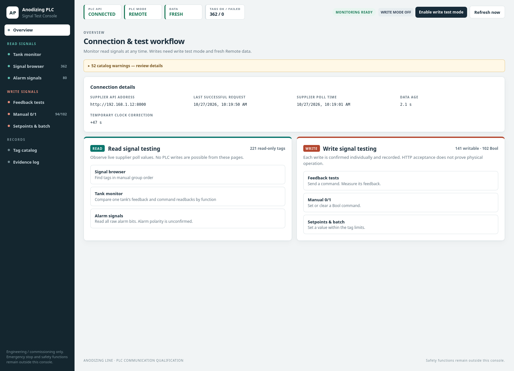
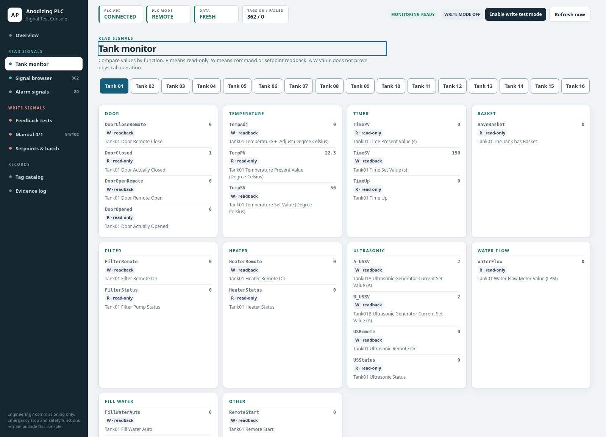
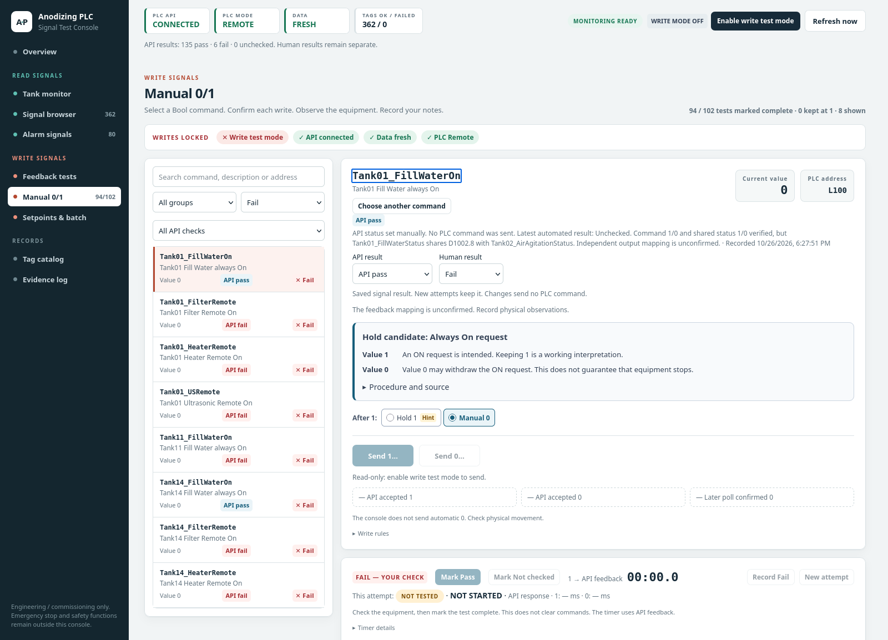
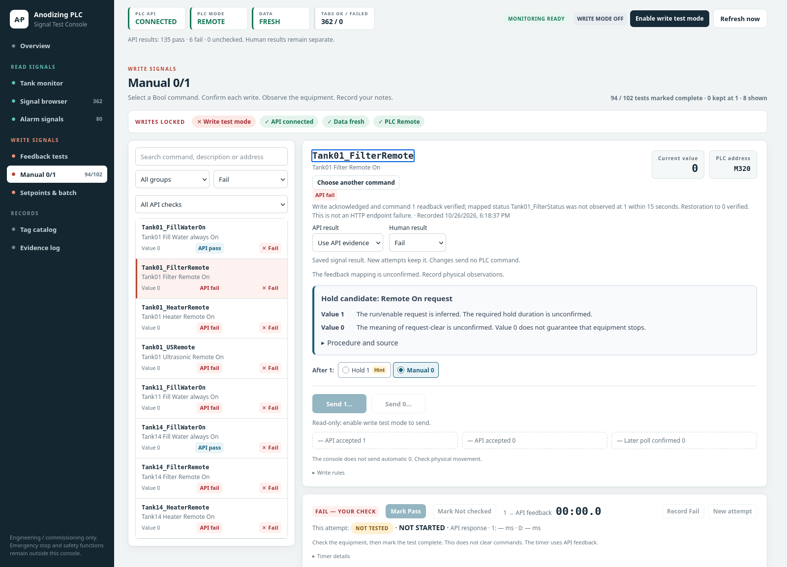

# Anodizing PLC Communication & Signal Test Console

This engineering console tests the supplier REST API before AGV or robot integration.
It records command values and feedback evidence. It is not a production controller or a safety system.
See [verification-2026-10-22.md](docs/verification-2026-10-22.md) for the first live reads and supervised Tank 01 tests.
Confirm the target, command/reset procedure and operator readiness before each physical test.

## Current field results

**Field tests: 26 October 2026. UI screenshots: 27 October 2026, Hong Kong time.**

| Check | Recorded result |
| --- | --- |
| Live catalog | 362 signals: 141 writable and 221 read-only |
| Direct single-write coverage | All 141 writable tags reached a reviewed result |
| Saved API labels | **135 Pass / 6 Fail / 0 Unchecked** |
| Saved human/operator results | **133 Pass / 8 Fail / 0 Not checked** |
| Eight-command API retest | All eight writes accepted, command readbacks verified, and commands restored to 0 |

API labels include human-Pass backfills and saved API label overrides.
They do not represent 135 independent automated completion tests.
The human Pass count includes Auto mode checks. Auto Pass confirms the mode bit, not automatic equipment operation.

### Eight human failures

All eight commands accepted writes and returned the written command value.
Output feedback and physical operation remain separate results.
The API retest used one command at a time, with a 15-second feedback window and verified restoration to 0.

| Command | Saved API result | Saved human result | Latest API evidence |
| --- | --- | --- | --- |
| `Tank01_FillWaterOn` | **Pass** | **Fail** | Command and shared status changed 1/0. Independent feedback mapping remains unconfirmed. |
| `Tank01_FilterRemote` | **Fail** | **Fail** | Command 1 verified. Filter status stayed 0. |
| `Tank01_HeaterRemote` | **Fail** | **Fail** | Command 1 verified. Heater status stayed 0. |
| `Tank01_USRemote` | **Fail** | **Fail** | Command 1 verified. Ultrasonic status stayed 0. |
| `Tank11_FillWaterOn` | **Fail** | **Fail** | Command 1 verified. Fill-water status stayed 0. |
| `Tank14_FillWaterOn` | **Pass** | **Fail** | Fresh command/status 1 observed. Command/status 0 restoration verified. |
| `Tank14_FilterRemote` | **Fail** | **Fail** | Command 1 verified. Filter status stayed 0. |
| `Tank14_HeaterRemote` | **Fail** | **Fail** | Command 1 verified. Heater status stayed 0. |

Both fill-water commands retain the operator's physical Fail despite their API Pass labels.
Tank01 fill feedback shares `D1002.8` with `Tank02_AirAgitationStatus`.
A shared status change does not independently prove Tank01 water flow.
Six human Fail marks reflect reviewed status timeouts. They do not independently prove a physical equipment fault.
A feedback timeout alone does not identify an HTTP failure, PLC fault or equipment interlock.

The direct run also recorded human Pass with unconfirmed API completion for `Tank10_DoorOpenRemote`.
The Tank11 sprinkler worked with RemoteStart ON while FillWaterAuto remained 1 in a separate controlled test.
That result does not establish a Start prerequisite for every command or tank.

See the [complete field review](docs/swagger-second-run-2026-10-26.txt) and [prerequisite findings](docs/api-prerequisites-2026-10-26.md).
Raw test reports and operator history remain local and excluded from Git.
This coverage does not establish a full browser-path comparison or supplier batch-write test.

### Web UI with current data

These screenshots show the running REAL-mode app with write mode off.
Live values reflect the capture time. Saved results reflect the field tests above.
The images are static snapshots.



<details>
<summary>Live tank readings</summary>

The tank monitor groups current command values, feedback and process readings.



</details>

<details>
<summary>API Pass with human Fail, and output-feedback failure</summary>

Tank01 fill-water shows the explicit API Pass and independent human Fail.
The screen retains the shared-feedback warning.



Tank01 filter shows API Fail and human Fail.
The detail records successful command readback and missing output feedback.



</details>

## PDF, Swagger and tank-name issues

The saved PDF table and API catalog match on all 362 names, addresses, types, permissions and multipliers.
That agreement does not prove correct physical equipment names or operating rules.

### Physical Tank13 door uses Tank12 tags

**Physical Tank12 has no door. The operator confirmed that these four Tank12 tags belong to the physical Tank13 door.**
Both the PDF and API contain this naming issue. It is not only a PDF/Swagger difference.

| Physical function | Name in both PDF and API | PLC address |
| --- | --- | --- |
| Tank13 door open | `Tank12_DoorOpenRemote` | `M310` |
| Tank13 door close | `Tank12_DoorCloseRemote` | `M311` |
| Tank13 door opened feedback | `Tank12_DoorOpened` | `D1116.4` |
| Tank13 door closed feedback | `Tank12_DoorClosed` | `D1116.5` |

No `Tank13_Door*` tags exist in the captured catalog.
Keep the published Tank12 names in API requests.
This correction applies to the four door tags only. Other Tank12 signals still refer to Tank12.

### Other document and example issues

| Source issue | Correct interpretation |
| --- | --- |
| PDF API example: `Tank01_TempSV=D4000` | The detailed table and API use `D4020`. `D4000` is `Tank01_TempPV`. |
| PDF batch example: `Tank01_HeaterOn` | This name is absent. The published command is `Tank01_HeaterRemote` at `M321`. |
| Swagger request example: `Tank1_AddWater` | This example name is absent from the actual catalog. Use a published writable tag. |
| Numeric limits | The PDF lists bounds for 39 tags. The API omits `low_limit` and `high_limit`. Missing bounds do not mean unlimited values. |
| Batch response | Swagger returns `results[]` and `count`. The request uses `writes[]`. The PDF does not define the response shape. |
| Validation errors | Swagger declares HTTP 422 for invalid requests. The PDF error table omits it. |
| Type metadata | Swagger permits a null `data_type`. All 362 captured tags have non-null types. |
| Temperature descriptions | Eight TempPV descriptions differ only in spacing. Their signal identities match. |

Swagger defines generic API routes, not one endpoint for each signal.
The live tag catalog supplies the actual signal names and metadata.
Neither source fully defines command prerequisites, feedback polarity, hold/reset sequences or expected completion times.
Write acceptance alone does not prove physical completion.

These shared addresses appear in both sources and still need supplier clarification:

| Address | Published signals |
| --- | --- |
| `D1002.8` | `Tank01_FillWaterStatus`, `Tank02_AirAgitationStatus` |
| `D1012.8` | `Tank03_FillWaterStatus`, `Tank04_AirAgitationStatus` |
| `D1022.8` | `Tank05_FillWaterStatus`, `Tank06_AirAgitationStatus` |
| `D1036` | `Tank08_WaterFlow`, `Tank09_WaterFlow` |
| `L220` | `Tank03_FillWaterAuto`, `Tank05_FillWaterAuto` |

See the [copyable difference table](docs/swagger-vs-pdf-differences.txt), [detailed audit](docs/swagger-alignment-2026-10-23.md), and [per-signal CSV](docs/swagger-signal-differences-2026-10-23.csv).

## Source and architecture

Use the **HKPU PLC_API_User_Manual** as the static supplier reference.
It identifies Project **PD-03726**, Model **KAL-1600-SG**, date **29-SEP-2026** and Version **1.0**.
The [PDF copy](docs/source/HKPU_PLC_API_User_Manual_PD-03726_2026-09-29.pdf) is in `docs/source`.
The repository keeps `Tag_catalog.docx` as a superseded historical reference.

The [PDF/Swagger alignment audit](docs/swagger-alignment-2026-10-23.md) compares
all 362 PDF rows with the saved supplier schema and catalog, with every differing
signal in a [CSV](docs/swagger-signal-differences-2026-10-23.csv). It records the
39 unpublished numeric limit pairs, eight spacing-only descriptions, stale
examples and shared physical/address issues. A fresh GET-only comparison at
20:05:19 Hong Kong time on 23 October 2026 confirmed the retained schema/catalog
still match the live server. These files are evidence, not a runtime fallback. The Tank12 door naming error also exists in
the captured API and is not corrected by renaming transport tags.

`config/mock-tags.json` contains a development snapshot with **362 tags, 141 writable and 221 read-only**.
The supported types are **Bool, Word, SignedWord and Float**.
REAL MODE uses live `GET /api/v1/tags/list` metadata for names, addresses, types, permissions, multipliers, descriptions and engineering limits.
The console gets tag counts from that metadata. Static addresses cannot route or authorize real writes.

The browser sends requests to the local FastAPI backend. Only the backend sends `X-API-Key` to the supplier.
The console does not access PLC registers directly.

```
Browser HTML/CSS/JS → local FastAPI backend → supplier PLC REST API → Wi-Fi → PLC
```

## Install and run

Requires Python 3.11 or newer.

Run the backend and frontend together:

```bash
./start
```

The launcher creates `.venv` and installs dependencies on the first run.
It installs them again when `requirements.txt` changes.
If `.env` is missing, it creates the file from `.env.example`.
It preserves existing configuration.

Open `http://127.0.0.1:8080`. Press Ctrl+C to stop the app.
For the remote PC, set `PLC_API_BASE_URL=http://192.168.1.12:8000`, `PLC_API_KEY` and `PLC_MOCK_MODE=false` in `.env`.
Then restart `./start`.

For manual setup:

```bash
python -m venv .venv
source .venv/bin/activate
pip install -r requirements.txt
cp .env.example .env
uvicorn server.app:app --host 127.0.0.1 --port 8080
```

Open `http://localhost:8080`.
For mock mode, leave `PLC_MOCK_MODE=true`. Mock mode needs no hardware or API key.
For real mode, configure `.env`:

1. Set `PLC_MOCK_MODE=false`.
2. Set `PLC_API_BASE_URL` to the actual supplier origin.
3. Set `PLC_API_KEY` to the supplier key.
4. Restart the backend.

The manual's `Tank01_TempSV=D4000` example differs from its detailed table, which uses `D4020`.
Record the live `/tags/list` metadata. Report discrepancies to the supplier.

The supplier API defaults to `PLC_API_HOST=127.0.0.1` and `PLC_API_PORT=8000`.
For access from another PC, the supplier host must listen on an accessible network interface.
The manual gives this PowerShell example:

```powershell
$env:PLC_API_HOST = "0.0.0.0"
$env:PLC_API_PORT = "8080"
python plc_api.py
```

`8080` is an example supplier port. It is separate from this console's port.
Get the actual API host IP, port and key from the supplier.
Then configure the connection:

```dotenv
PLC_API_BASE_URL=http://<supplier-api-ip>:<port>
PLC_API_KEY=<key>
PLC_MOCK_MODE=false
```

The command `uvicorn server.app:app --host 0.0.0.0 --port 8080` permits LAN access for monitoring.
Write and test endpoints accept loopback clients only.
Use the browser on the backend host for writes. Alternatively, use a local SSH tunnel.

From the engineer laptop, start `ssh -L 8080:127.0.0.1:8080 user@backend-host`.
Then open `http://localhost:8080`.
Restrict the backend host and `.env` to authorized engineers.
The local UI has no user accounts or TLS. Use a trusted workstation and tunnel.

## Configuration

| Variable | Meaning |
| --- | --- |
| `PLC_API_BASE_URL` | Supplier API origin, e.g. `http://192.168.x.x:8000` |
| `PLC_API_KEY` | Supplier credential. Backend only |
| `PLC_REQUEST_TIMEOUT` | HTTP timeout seconds |
| `PLC_UI_POLL_INTERVAL_MS` | Browser poll interval. Minimum 250 ms |
| `PLC_STALE_AFTER_MS` | Maximum accepted supplier data age |
| `PLC_TIMESTAMP_TIMEZONE` | Confirmed supplier timezone for timestamps without an offset, e.g. `Asia/Hong_Kong`. Blank rejects them |
| `PLC_TIMESTAMP_OFFSET_SECONDS` | Temporary signed whole seconds added for freshness and event-time comparison. Default `0` |
| `PLC_MOCK_MODE` | `true` for the generated mock catalog |

Git ignores `.env`.
The backend removes credentials from supplier errors before it writes logs or sends browser responses.
It writes logs to the ignored file `logs/events.jsonl`.
The in-memory export view keeps a limited number of entries.
After restart, the backend loads the latest 10,000 saved entries into that view.

## Operating modes and write safety

Each page load starts in **READ-ONLY MODE**. A refresh discards the browser's write token.
A backend restart invalidates all tokens. Each token expires after 30 minutes.
Select **Enable write test mode** beside **Refresh now** to permit writes.
The compact badge distinguishes application authorization from PLC Remote mode.

Each manual single or batch write opens a confirmation dialog. The batch endpoint also requires the exact confirmation text.
Before dispatch, the backend checks live metadata, type, limits, fresh data and `Remote=1`.
It checks the mode token again after network validation, including before configured reset writes.
The UI shows `Local` and `Remote` from the live catalog.
The console records HTTP acceptance separately from physical feedback.

A short command lock protects actual writes. Independent feedback observations can run in parallel.
Conflict checks protect the same command, aliases, opposing doors and shared feedback resources.
Disabling write mode blocks commands that the backend has not dispatched.
It cannot recall a submitted command.

The web app does not infer automatic resets.
A configured test can include an explicit `reset_command`.
No test or write starts when a page loads. Emergency stop remains outside this application.
A catalog `W` marker alone does not establish safe field behavior.
The line engineer must check the physical test area and equipment state.

Signal browser groups matching cards by the manual's Alarms, System and tank sections.
Each group shows its count. Each card shows its full description.
Search and group/type/permission filters reach every tag. There is no first-120 cutoff.

## 0/1 command checklist

The checklist lists every live writable Bool tag, currently 102.
Search by name or filter by tank/group. Each **Send 1…** or **Send 0…** action uses one confirmation popup.
The completion timer starts when you confirm Send 1.
It stops when fresh configured feedback reports completion.
The UI shows API response time and later 0 readback separately.
**New attempt** leaves its timer at zero.

The end-state control offers Manual 0 or Hold at 1.
Manual-based Hold hints remain unconfirmed. Only the tested Tank 01 rule marks Manual 0 as confirmed.
For a non-door Hold, the UI records Keep at 1 after accepted 1 and verified later readback.
This records the confirmed choice without an additional write.

Detailed logs update automatically. Enter physical observations in Notes.
**API CYCLE RECORDED** describes command evidence.
Only an explicit human result marks a test complete.
The checklist does not automatically clear or retry commands.

History stays in this browser for the selected API and mode.
Export it as CSV/JSON. A refresh starts with write mode off.
Setpoints & batch, `#/write`, includes numeric setpoints and all 141 writable tags.
See the [user guide](docs/user-guide.md#01-command-checklist) for procedures and limits.
The [hold/reset findings](docs/signal-test-plan.md#command-hold-and-reset-findings) distinguish manual descriptions, the tested Tank 01 procedure and unspecified RemoteStart behavior.

If the API catalog is unavailable at startup, the UI retries after communication returns.
The Commands page identifies loading, unavailable, empty-catalog and empty-filter states.
Selected commands show Hold/Reset guidance with its source and confirmation status.
Each write still requires an explicit action.

## Command/feedback tests

A feedback wait does not lock unrelated commands.
Use **Test run** to select an ongoing or finished run.
Each run keeps its timeout, request timer, API result and human result.
Pending commands stay visible.

An explicit same-command Send 0 interrupts its observer. It does not infer completion.
The backend serializes actual dispatches.
Each write requires fresh Remote data and one confirmation.

All 50 bundled feedback tests default to a **15-second observation window**.
The Feedback tests wait-limit field accepts whole seconds from 1 to 300 for the next run.
The confirmation and audit show the selected limit.
A timeout leaves the command state for manual review and clearing.

Feedback uses the Manual 0/1 layout.
The left side contains the searchable pair list and tank/result dropdowns.
The right side contains the selected details and results.
The shared Command bits bar appears on all three write pages.

The **Your result** dropdown saves **Not checked**, **Pass** or **Fail** immediately in this browser.
API feedback does not set that choice.
A manual-based Hold suggestion selects the initial Feedback mode.
Doors and commands without a clear suggestion start on Manual 0.
The confirmation shows the source. It permits an override for a non-door command.

`config/test-cases.json` includes configured door open/close pairs and 36 manual-derived non-door pairs labelled **MAPPING UNDER TEST**.
Their `requires_confirmation` flags remain set.
The UI permits supervised observation only after explicit confirmation.
A matching transition returns **OBSERVED**, not PASS.
This does not certify the mapping or hold/reset behavior.

A configured test checks baseline feedback again before dispatch.
It writes one engineering value.
PASS requires a newer poll timestamp at or after command acceptance.
The backend applies the configured timezone and temporary clock correction to poll timestamps.
It does not use cyclic poll_count values as a sequence.

The backend limits each feedback read to the remaining test time.
Late feedback cannot pass. Revoked write mode or loss of Remote mode stops verification.
The runner does not infer a reset.
Export results and communication records as CSV or JSON.

The snapshot contains eight Float tags. All are read-only.
A physical writable Float test needs a supplier tag marked `W` in `/tags/list`.
SignedWord represents a signed 16-bit register.
Writes accept negative engineering values within live limits.

The supplier performs scaling.
`Tank01_TempAdj=-5.0` with multiplier `0.1` sends `-5.0`.
`Tank01_TempSV=25.0` sends `25.0`.


The write sidebar separates Feedback tests, Manual 0/1, and Setpoints & batch. Each active command row has its own confirmed **Send 0…** action. It also works after reload without starting a test.

Feedback keeps selected-pair details and **Active test & result** in the right workspace.
Reviewing a pair sends nothing. **Run selected test** opens one write confirmation.
Each row shows its saved human Pass/Fail separately from API outcomes.

All 50 pairs use tags from the supplier tables.
Those sources do not define the command-to-feedback operating rules.
The 14 Local pairs and 36 mappings under test are application classifications, not supplier confirmation.
Operator Pass records the physical check reported by the tester.
**Send 0…** remains explicit. The initial cases do not send an automatic reset.
See the [user guide](docs/user-guide.md).

## Catalog compatibility and diagnostics

The [test plan](docs/signal-test-plan.md) records the changes.
REAL MODE compares live metadata with the bundled baseline.
It shows and logs **CATALOG DIFFERENCE** warnings for added/missing tags, count differences and changed metadata.
It uses the live metadata unchanged.
Warnings alone do not block monitoring or writes. Existing write protections still apply.

**SUPPLIER CONFIRMATION REQUIRED: Tank08_WaterFlow and Tank09_WaterFlow both use D1036 in the latest manual.**
The console keeps both supplied tags unchanged.
It reports duplicate addresses as warnings and duplicate tag names as errors.
The latest table also repeats `L220` for Tank03/Tank05 fill-water-auto.

## First real API smoke test: read only

```bash
export PLC_MOCK_MODE=false
export PLC_API_BASE_URL='http://<supplier-ip>:<port>'
export PLC_API_KEY='<key>'
uvicorn server.app:app --host 127.0.0.1 --port 8080
```

From another terminal on the backend host:

```bash
curl --fail-with-body http://127.0.0.1:8080/api/tags
curl --fail-with-body http://127.0.0.1:8080/api/signals
curl --fail-with-body http://127.0.0.1:8080/api/status
```

If the supplier omits a timestamp offset, confirm its clock timezone first.
Then set `PLC_TIMESTAMP_TIMEZONE=Asia/Hong_Kong` when that timezone applies.
The console honors existing timezone offsets. Timezone configuration does not correct clock drift.

For a measured supplier clock delay of 44 seconds, set `PLC_TIMESTAMP_OFFSET_SECONDS=44` in `.env`.
Restart `./start` after the change. The UI shows the correction separately.
The raw supplier timestamps and 3-second stale-data limit remain unchanged.
An incorrect offset can make data stale or apparently in the future.
Measure the delay again if either clock changes.

After clock synchronization, reset the offset to `0`. Then restart the backend.

Before a write test, `/api/tags` must parse all live supplier tags, including SignedWord.
Keep the initial checks read-only.
Review these items with the supplier:

- API connection.
- Remote/Local state.
- Timestamp with a known timezone and acceptable age.
- Live tag counts and parsing errors.
- Catalog warnings.

Enable write test mode only after the engineer reviews these results and authorizes the physical test.

## Verification

Run `pytest -q` in the activated virtual environment.
Browser tests use an isolated loopback fake API. They run when Firefox and geckodriver are available.
Otherwise, pytest reports them as skipped. These tests do not use the line API.
If the shell inherits unrelated ROS Python plugins, use `env -u PYTHONPATH pytest -q`.

The dated verification notes record their own test results and field conditions.
See [22 October verification](docs/verification-2026-10-22.md) for the first live reads and bug corrections.
See [23 October verification](docs/verification-2026-10-23.md#feature-branch-push-preparation) for its 598-test evidence and stopped field session.
See [26 October results](docs/swagger-second-run-2026-10-26.txt) for the completed direct 141-tag run and later API retest.

For mock fault injection, send `POST /api/mock/fault` from loopback.
The next mock read returns a communication error. This endpoint returns 404 in real mode.
See the [test plan](docs/signal-test-plan.md), [user guide](docs/user-guide.md) and [mock report](docs/mock-verification-report.md) for procedures and evidence.

For a Bool engineering value, choose **0** or **1**.
Numeric setpoints keep numeric input. Each write still needs Review and confirmation.
Value and batch histories use the same saved human-result labels.

The supplier batch response uses `results` and `count`.
The console checks every accepted item.
The latest verification notes record live field evidence and remaining PLC questions.
